<p align="center">
  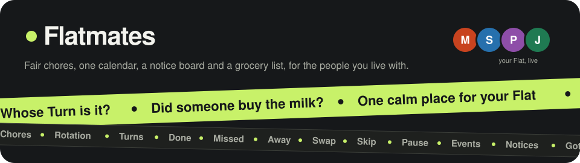
</p>

Flatmates helps the people sharing a flat split recurring chores fairly. It also gives the flat one shared calendar, a notice board and a grocery list.

The app is built with Flutter (iOS, Android and web) and talks to a [Serverpod](https://serverpod.dev) 4 backend on PostgreSQL. Mates sign in with Google, and every change appears live on the other Mates' phones.

> [!IMPORTANT]
> **Want to run it?** Check the [Requirements](#requirements), then follow the four steps in [Getting started](#getting-started). You also need to set up [Google sign-in](#google-sign-in), because it is the only way to sign in.

> [!NOTE]
> **Tested on Android only.** The app has been built, tested and run on Android phones. The project includes an iOS target, but it hasn't been tested on iOS, so the build, sign-in or push notifications may not work there yet.

---

## Screens

A walk through the main screens, in the order a new Mate meets them. **Swipe or scroll sideways to go through the steps. →**

<div style="width: 100%; max-width: 100%; overflow-x: auto; overflow-y: hidden; border: 1px solid rgba(127,127,127,.25); border-radius: 12px; padding: 8px;">

<table>
  <tr>
    <td align="center" valign="top" width="220" style="min-width: 220px;">
      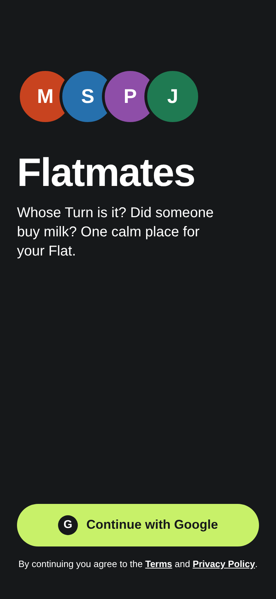<br>
      <b>1. Sign in</b><br>
      <sub>Sign in with Google.</sub>
      <br>&nbsp;&nbsp;&nbsp;&nbsp;&nbsp;&nbsp;&nbsp;&nbsp;&nbsp;&nbsp;&nbsp;&nbsp;&nbsp;&nbsp;&nbsp;&nbsp;&nbsp;&nbsp;&nbsp;&nbsp;&nbsp;&nbsp;&nbsp;&nbsp;&nbsp;&nbsp;&nbsp;&nbsp;&nbsp;&nbsp;&nbsp;&nbsp;&nbsp;&nbsp;&nbsp;&nbsp;&nbsp;&nbsp;&nbsp;&nbsp;&nbsp;&nbsp;&nbsp;&nbsp;&nbsp;&nbsp;&nbsp;&nbsp;&nbsp;&nbsp;&nbsp;&nbsp;
    </td>
    <td align="center" valign="top" width="220" style="min-width: 220px;">
      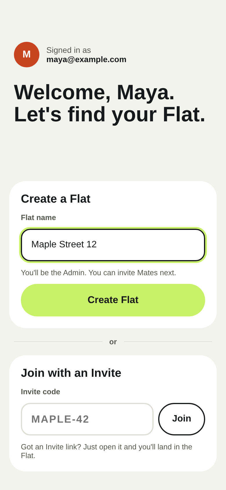<br>
      <b>2. Create or join a Flat</b><br>
      <sub>Start a Flat, or join one with an Invite code.</sub>
      <br>&nbsp;&nbsp;&nbsp;&nbsp;&nbsp;&nbsp;&nbsp;&nbsp;&nbsp;&nbsp;&nbsp;&nbsp;&nbsp;&nbsp;&nbsp;&nbsp;&nbsp;&nbsp;&nbsp;&nbsp;&nbsp;&nbsp;&nbsp;&nbsp;&nbsp;&nbsp;&nbsp;&nbsp;&nbsp;&nbsp;&nbsp;&nbsp;&nbsp;&nbsp;&nbsp;&nbsp;&nbsp;&nbsp;&nbsp;&nbsp;&nbsp;&nbsp;&nbsp;&nbsp;&nbsp;&nbsp;&nbsp;&nbsp;&nbsp;&nbsp;&nbsp;&nbsp;
    </td>
    <td align="center" valign="top" width="220" style="min-width: 220px;">
      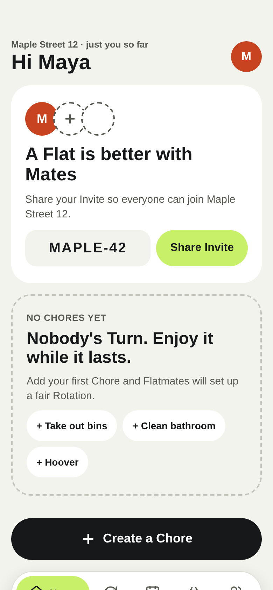<br>
      <b>3. Empty Home</b><br>
      <sub>A new Flat with no Chores yet. Share the Invite to bring Mates in.</sub>
      <br>&nbsp;&nbsp;&nbsp;&nbsp;&nbsp;&nbsp;&nbsp;&nbsp;&nbsp;&nbsp;&nbsp;&nbsp;&nbsp;&nbsp;&nbsp;&nbsp;&nbsp;&nbsp;&nbsp;&nbsp;&nbsp;&nbsp;&nbsp;&nbsp;&nbsp;&nbsp;&nbsp;&nbsp;&nbsp;&nbsp;&nbsp;&nbsp;&nbsp;&nbsp;&nbsp;&nbsp;&nbsp;&nbsp;&nbsp;&nbsp;&nbsp;&nbsp;&nbsp;&nbsp;&nbsp;&nbsp;&nbsp;&nbsp;&nbsp;&nbsp;&nbsp;&nbsp;
    </td>
    <td align="center" valign="top" width="220" style="min-width: 220px;">
      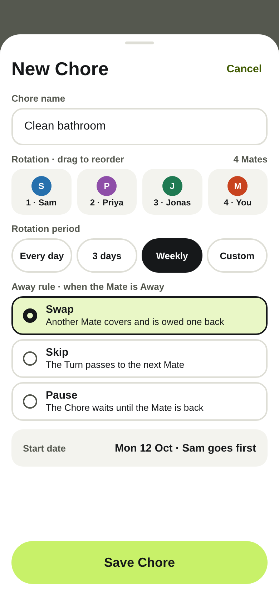<br>
      <b>4. Add a Chore</b><br>
      <sub>The Admin picks the Rotation and Rotation period.</sub>
      <br>&nbsp;&nbsp;&nbsp;&nbsp;&nbsp;&nbsp;&nbsp;&nbsp;&nbsp;&nbsp;&nbsp;&nbsp;&nbsp;&nbsp;&nbsp;&nbsp;&nbsp;&nbsp;&nbsp;&nbsp;&nbsp;&nbsp;&nbsp;&nbsp;&nbsp;&nbsp;&nbsp;&nbsp;&nbsp;&nbsp;&nbsp;&nbsp;&nbsp;&nbsp;&nbsp;&nbsp;&nbsp;&nbsp;&nbsp;&nbsp;&nbsp;&nbsp;&nbsp;&nbsp;&nbsp;&nbsp;&nbsp;&nbsp;&nbsp;&nbsp;&nbsp;&nbsp;
    </td>
    <td align="center" valign="top" width="220" style="min-width: 220px;">
      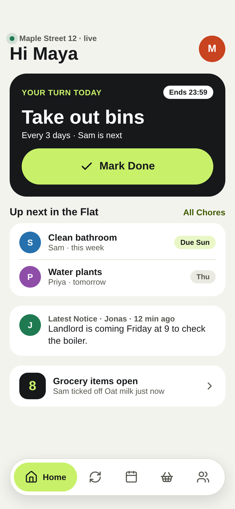<br>
      <b>5. Home</b><br>
      <sub>Your Turn today (tap Mark Done), what's next, the latest Notice and groceries.</sub>
      <br>&nbsp;&nbsp;&nbsp;&nbsp;&nbsp;&nbsp;&nbsp;&nbsp;&nbsp;&nbsp;&nbsp;&nbsp;&nbsp;&nbsp;&nbsp;&nbsp;&nbsp;&nbsp;&nbsp;&nbsp;&nbsp;&nbsp;&nbsp;&nbsp;&nbsp;&nbsp;&nbsp;&nbsp;&nbsp;&nbsp;&nbsp;&nbsp;&nbsp;&nbsp;&nbsp;&nbsp;&nbsp;&nbsp;&nbsp;&nbsp;&nbsp;&nbsp;&nbsp;&nbsp;&nbsp;&nbsp;&nbsp;&nbsp;&nbsp;&nbsp;&nbsp;&nbsp;
    </td>
    <td align="center" valign="top" width="220" style="min-width: 220px;">
      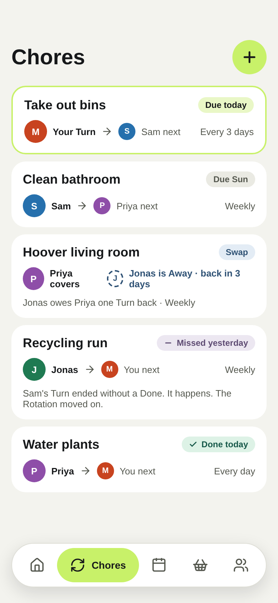<br>
      <b>6. Chores</b><br>
      <sub>Every Chore, whose Turn it is and who's next, including covers and Missed Turns.</sub>
      <br>&nbsp;&nbsp;&nbsp;&nbsp;&nbsp;&nbsp;&nbsp;&nbsp;&nbsp;&nbsp;&nbsp;&nbsp;&nbsp;&nbsp;&nbsp;&nbsp;&nbsp;&nbsp;&nbsp;&nbsp;&nbsp;&nbsp;&nbsp;&nbsp;&nbsp;&nbsp;&nbsp;&nbsp;&nbsp;&nbsp;&nbsp;&nbsp;&nbsp;&nbsp;&nbsp;&nbsp;&nbsp;&nbsp;&nbsp;&nbsp;&nbsp;&nbsp;&nbsp;&nbsp;&nbsp;&nbsp;&nbsp;&nbsp;&nbsp;&nbsp;&nbsp;&nbsp;
    </td>
    <td align="center" valign="top" width="220" style="min-width: 220px;">
      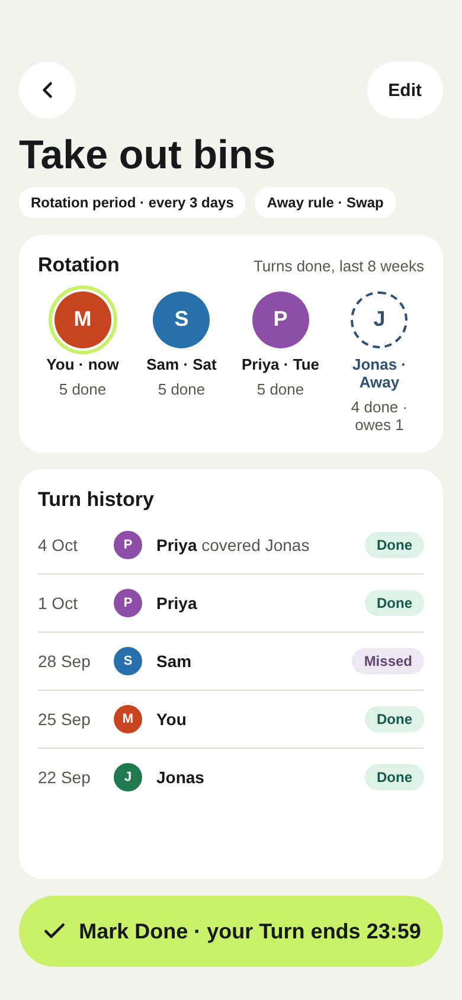<br>
      <b>7. Chore detail</b><br>
      <sub>The Rotation, Turns done per Mate, Turns owed back and the Turn history.</sub>
      <br>&nbsp;&nbsp;&nbsp;&nbsp;&nbsp;&nbsp;&nbsp;&nbsp;&nbsp;&nbsp;&nbsp;&nbsp;&nbsp;&nbsp;&nbsp;&nbsp;&nbsp;&nbsp;&nbsp;&nbsp;&nbsp;&nbsp;&nbsp;&nbsp;&nbsp;&nbsp;&nbsp;&nbsp;&nbsp;&nbsp;&nbsp;&nbsp;&nbsp;&nbsp;&nbsp;&nbsp;&nbsp;&nbsp;&nbsp;&nbsp;&nbsp;&nbsp;&nbsp;&nbsp;&nbsp;&nbsp;&nbsp;&nbsp;&nbsp;&nbsp;&nbsp;&nbsp;
    </td>
    <td align="center" valign="top" width="220" style="min-width: 220px;">
      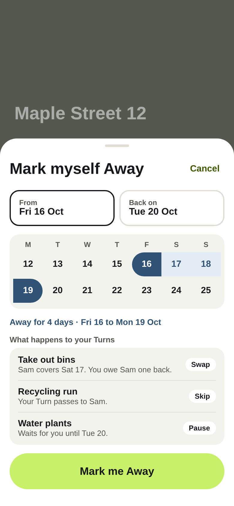<br>
      <b>8. Away</b><br>
      <sub>Pick your dates and see what happens to each of your Turns.</sub>
      <br>&nbsp;&nbsp;&nbsp;&nbsp;&nbsp;&nbsp;&nbsp;&nbsp;&nbsp;&nbsp;&nbsp;&nbsp;&nbsp;&nbsp;&nbsp;&nbsp;&nbsp;&nbsp;&nbsp;&nbsp;&nbsp;&nbsp;&nbsp;&nbsp;&nbsp;&nbsp;&nbsp;&nbsp;&nbsp;&nbsp;&nbsp;&nbsp;&nbsp;&nbsp;&nbsp;&nbsp;&nbsp;&nbsp;&nbsp;&nbsp;&nbsp;&nbsp;&nbsp;&nbsp;&nbsp;&nbsp;&nbsp;&nbsp;&nbsp;&nbsp;&nbsp;&nbsp;
    </td>
    <td align="center" valign="top" width="220" style="min-width: 220px;">
      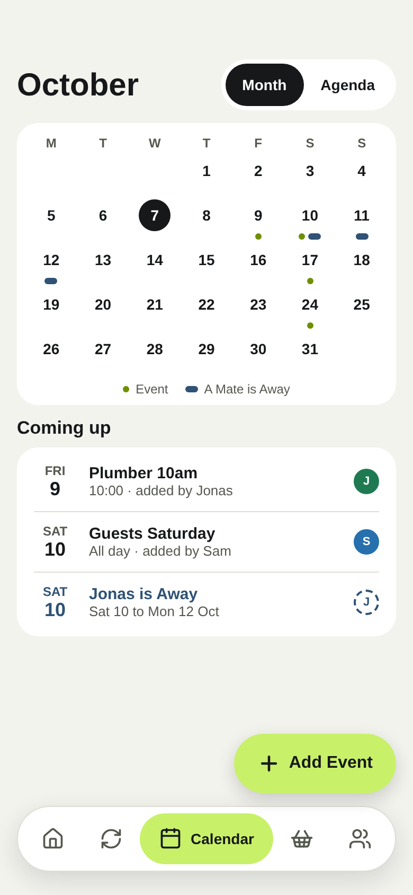<br>
      <b>9. Calendar</b><br>
      <sub>Events and who's Away, on one shared calendar.</sub>
      <br>&nbsp;&nbsp;&nbsp;&nbsp;&nbsp;&nbsp;&nbsp;&nbsp;&nbsp;&nbsp;&nbsp;&nbsp;&nbsp;&nbsp;&nbsp;&nbsp;&nbsp;&nbsp;&nbsp;&nbsp;&nbsp;&nbsp;&nbsp;&nbsp;&nbsp;&nbsp;&nbsp;&nbsp;&nbsp;&nbsp;&nbsp;&nbsp;&nbsp;&nbsp;&nbsp;&nbsp;&nbsp;&nbsp;&nbsp;&nbsp;&nbsp;&nbsp;&nbsp;&nbsp;&nbsp;&nbsp;&nbsp;&nbsp;&nbsp;&nbsp;&nbsp;&nbsp;
    </td>
    <td align="center" valign="top" width="220" style="min-width: 220px;">
      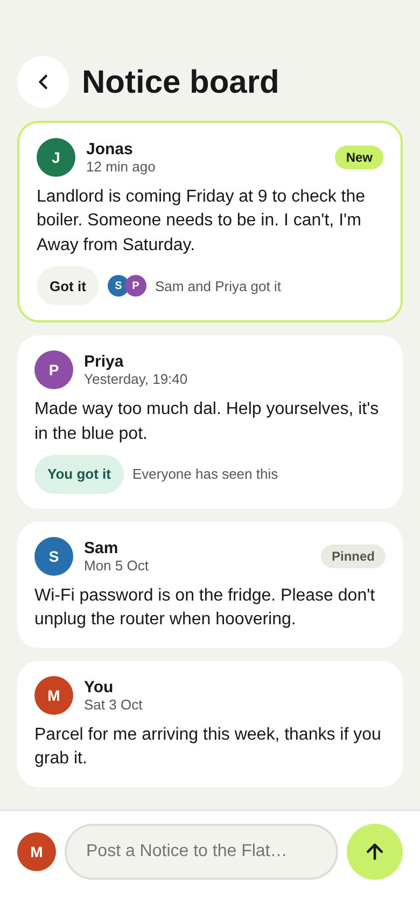<br>
      <b>10. Notice board</b><br>
      <sub>Post a Notice; Mates tap Got it.</sub>
      <br>&nbsp;&nbsp;&nbsp;&nbsp;&nbsp;&nbsp;&nbsp;&nbsp;&nbsp;&nbsp;&nbsp;&nbsp;&nbsp;&nbsp;&nbsp;&nbsp;&nbsp;&nbsp;&nbsp;&nbsp;&nbsp;&nbsp;&nbsp;&nbsp;&nbsp;&nbsp;&nbsp;&nbsp;&nbsp;&nbsp;&nbsp;&nbsp;&nbsp;&nbsp;&nbsp;&nbsp;&nbsp;&nbsp;&nbsp;&nbsp;&nbsp;&nbsp;&nbsp;&nbsp;&nbsp;&nbsp;&nbsp;&nbsp;&nbsp;&nbsp;&nbsp;&nbsp;
    </td>
    <td align="center" valign="top" width="220" style="min-width: 220px;">
      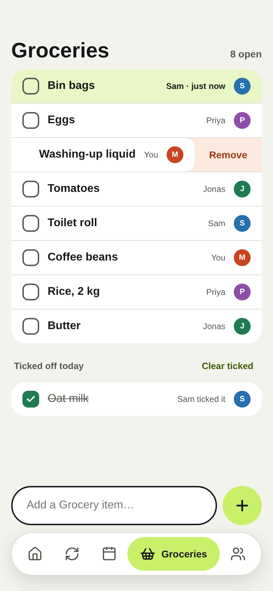<br>
      <b>11. Groceries</b><br>
      <sub>One shared list for the whole Flat.</sub>
      <br>&nbsp;&nbsp;&nbsp;&nbsp;&nbsp;&nbsp;&nbsp;&nbsp;&nbsp;&nbsp;&nbsp;&nbsp;&nbsp;&nbsp;&nbsp;&nbsp;&nbsp;&nbsp;&nbsp;&nbsp;&nbsp;&nbsp;&nbsp;&nbsp;&nbsp;&nbsp;&nbsp;&nbsp;&nbsp;&nbsp;&nbsp;&nbsp;&nbsp;&nbsp;&nbsp;&nbsp;&nbsp;&nbsp;&nbsp;&nbsp;&nbsp;&nbsp;&nbsp;&nbsp;&nbsp;&nbsp;&nbsp;&nbsp;&nbsp;&nbsp;&nbsp;&nbsp;
    </td>
    <td align="center" valign="top" width="220" style="min-width: 220px;">
      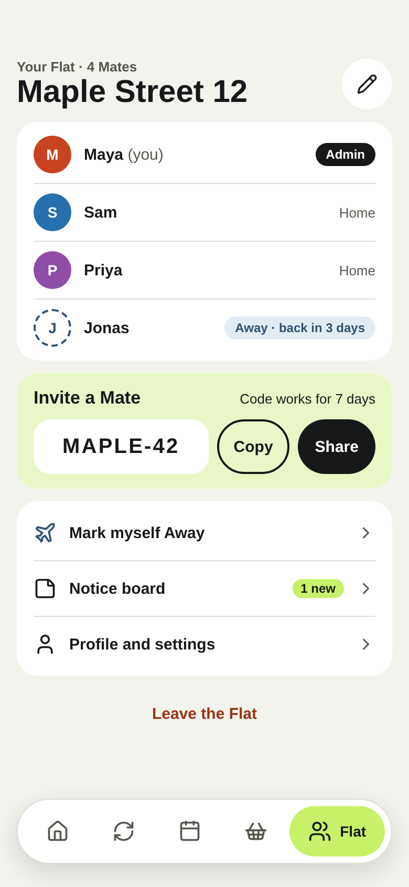<br>
      <b>12. Flat</b><br>
      <sub>Mates, the Invite code, and links to Away, Notices and settings.</sub>
      <br>&nbsp;&nbsp;&nbsp;&nbsp;&nbsp;&nbsp;&nbsp;&nbsp;&nbsp;&nbsp;&nbsp;&nbsp;&nbsp;&nbsp;&nbsp;&nbsp;&nbsp;&nbsp;&nbsp;&nbsp;&nbsp;&nbsp;&nbsp;&nbsp;&nbsp;&nbsp;&nbsp;&nbsp;&nbsp;&nbsp;&nbsp;&nbsp;&nbsp;&nbsp;&nbsp;&nbsp;&nbsp;&nbsp;&nbsp;&nbsp;&nbsp;&nbsp;&nbsp;&nbsp;&nbsp;&nbsp;&nbsp;&nbsp;&nbsp;&nbsp;&nbsp;&nbsp;
    </td>
  </tr>
</table>

</div>

<sub>These are renders from the design spec in [`design/`](design/). Each one has an HTML version in [`design/screens/`](design/screens/) with the exact colours, sizes and spacing. More screens are in [`design/screenshots/`](design/screenshots/): dark mode, empty, offline and loading states, notifications, settings and the component sheet.</sub>

## Requirements

| Tool | Version | Notes |
|---|---|---|
| Flutter | **≥ 3.47** (Dart **≥ 3.13**) | The committed `pubspec.lock` needs this. Check with `flutter --version`, and run `flutter upgrade` if yours is older. |
| Serverpod CLI | 4.x | `dart pub global activate serverpod_cli` |
| Docker | any recent | Runs Postgres for development and tests. |
| Xcode / Android Studio | current | For iOS or Android builds. |
| Google Cloud project | n/a | For Google sign-in (see [Google sign-in](#google-sign-in)). |
| Firebase project | optional | For push notifications. Without it, they are written to the server log instead. |

## Getting started

### 1. Clone and fetch dependencies

```sh
git clone git@github.com:Sushil787/FlatMate.git
cd FlatMate
flutter pub get          # run at the root: resolves all three workspace packages
```

### 2. Create the server's secrets file

`flatmates_server/config/passwords.yaml` is git-ignored, so a fresh clone doesn't have it. Create it:

```yaml
# flatmates_server/config/passwords.yaml. Local secrets, never commit.
shared:
  # Google sign-in: the Web OAuth client JSON, on one line (see "Google sign-in")
  # googleClientSecret: '{"web":{"client_id":"...","client_secret":"..."}}'
  # Push notifications: a Firebase service account JSON (optional)
  # fcmServiceAccount: '{"type":"service_account", ...}'

development:
  database: '<POSTGRES_PASSWORD of the "postgres" service in docker-compose.yaml>'
  redis: '<password of the "redis" service in docker-compose.yaml>'
  serviceSecret: '<any long random string>'
  emailSecretHashPepper: '<any long random string>'
  jwtRefreshTokenHashPepper: '<any long random string>'

test:
  database: '<POSTGRES_PASSWORD of the "postgres_test" service in docker-compose.yaml>'
  redis: '<password of the "redis_test" service in docker-compose.yaml>'
  emailSecretHashPepper: '<any long random string>'
  jwtRefreshTokenHashPepper: '<any long random string>'
```

You can generate the random strings with `openssl rand -base64 32`.

> [!IMPORTANT]
> Uncomment `googleClientSecret` and fill it in before you start the server. Without it, Google sign-in is turned off and nobody can sign in. [Google sign-in](#google-sign-in) shows how to get it.

### 3. Start the database and the server

```sh
cd flatmates_server
docker compose up -d                      # Postgres: dev on :8090, tests on :9090
dart bin/main.dart --apply-migrations     # API on :8080, Insights on :8081, web on :8082
```

The server applies any pending migrations when it starts. Leave this terminal running.

### 4. Run the app

In a second terminal:

```sh
cd flatmates_flutter
flutter run --dart-define=SERVER_URL=http://localhost:8080/
```

See [Running the app](#running-the-app) for emulators, physical devices and web.

## Repository layout

This is a [Dart pub workspace](https://dart.dev/tools/pub/workspaces): one root `pubspec.yaml` and one `pubspec.lock` cover three packages.

```
.
├── pubspec.yaml            # workspace root
├── GLOSSARY.md             # domain language (source of truth)
├── CLAUDE.md               # notes for AI coding assistants
├── design/                 # UI spec: HTML screens, PNG renders, theme tokens
│
├── flatmates_server/       # Serverpod backend
│   ├── bin/main.dart       # entry point
│   ├── config/             # development / test / staging / production .yaml (+ passwords.yaml, git-ignored)
│   ├── docker-compose.yaml # Postgres + Redis for dev and tests
│   ├── migrations/         # database migrations (committed)
│   ├── lib/src/
│   │   ├── models/         # *.spy.yaml data models
│   │   ├── endpoints/      # flat, chore, away, event, notice, grocery
│   │   ├── rotation/       # planner.dart (pure logic) + turn_service.dart (DB + scheduling)
│   │   ├── future_calls/   # Turn start / reminder / end, run as Serverpod FutureCalls
│   │   ├── notify/         # FCM push notifications
│   │   ├── auth/           # sign-in helpers
│   │   └── flat_access.dart# requireMate / requireAdmin / fail / broadcast
│   └── test/
│       ├── unit/           # planner, day, digests
│       └── integration/    # full flows against Postgres
│
├── flatmates_client/       # GENERATED by `serverpod generate`. Do not edit by hand.
│
└── flatmates_flutter/      # Flutter app
    ├── assets/config.json  # default server URL
    ├── google_web.json     # Google client IDs for web
    ├── run_device.sh       # run on a physical device against this machine
    ├── lib/
    │   ├── main.dart
    │   ├── app/            # app widget, router (auto_route)
    │   ├── core/           # theme, shared widgets, providers
    │   └── features/       # auth, home, chores, away, calendar, board, groceries, flat, settings
    └── test/               # widget tests run against a FakeBackend
```

Each app feature is split into `data/` (a repository around the generated client), `application/` (Riverpod controllers), `domain/` (view models) and `presentation/` (screens and widgets).

## Running the app

The app chooses its server URL in this order:

1. `--dart-define=SERVER_URL=...` if you pass it.
2. Otherwise, `apiUrl` from [`flatmates_flutter/assets/config.json`](flatmates_flutter/assets/config.json), which currently points at a LAN address. Edit it for your own network, or pass `SERVER_URL` instead.

| Target | Command (from `flatmates_flutter/`) |
|---|---|
| iOS simulator / desktop | `flutter run --dart-define=SERVER_URL=http://localhost:8080/` |
| Android emulator | `flutter run --dart-define=SERVER_URL=http://10.0.2.2:8080/` (the emulator reaches your machine at `10.0.2.2`) |
| Physical phone on Linux | `./run_device.sh -d <device-id>` (finds this machine's LAN IP itself) |
| Physical phone on macOS | `flutter run -d <device-id> --dart-define=SERVER_URL=http://$(ipconfig getifaddr en0):8080/` |
| Web | `flutter run -d chrome --web-port 5000 --dart-define-from-file=google_web.json --dart-define=SERVER_URL=http://localhost:8080/` |
| Against the cloud server | `flutter run --dart-define=SERVER_URL=https://<your-api-host>/` |

**Physical devices:** the phone has to be on the same Wi-Fi as your machine, and port 8080 has to be reachable from the network.
- Linux: `sudo ufw allow from 192.168.0.0/16 to any port 8080 proto tcp`.
- macOS: allow incoming connections for `dart` when the firewall asks.

Also set `apiServer.publicHost` in `flatmates_server/config/development.yaml` to your LAN IP.

`run_device.sh` uses `ip route`, which only exists on Linux. On macOS, use the `ipconfig getifaddr` command from the table above.

## Google sign-in

Google is the only way to sign in. The server turns Google sign-in on only when `googleClientSecret` is set, so you need this setup even for local development.

1. In the **Google Cloud console**, under **APIs & Services → Credentials**, create these OAuth client IDs:
   - a **Web application** client, used by the server and by the web app,
   - an **iOS** client (bundle ID from `ios/Runner.xcodeproj`),
   - an **Android** client (package name plus the SHA-1 of your signing key, which `cd android && ./gradlew signingReport` prints).
2. Download the Web client's JSON and paste it on one line into `passwords.yaml` as `googleClientSecret` (under `shared:` or a specific run mode).
3. **Web app:** put the client IDs in [`flatmates_flutter/google_web.json`](flatmates_flutter/google_web.json), then run with `--dart-define-from-file=google_web.json`. The sign-in redirect returns to `web/auth.html`, so add `http://localhost:5000/auth.html` as an authorised redirect URI on the Web client.
4. **iOS:** in `ios/Runner/Info.plist`, set `GIDClientID` to the iOS client ID and add the *reversed* client ID under `CFBundleURLSchemes`.
5. **Android:** the client is matched through `android/app/google-services.json` and your signing SHA-1.

## Push notifications (FCM)

Push notifications are optional. Until you set them up, everything else still works, and each push is written to the server log as `FCM not configured …`.

1. Create a Firebase project and run `flutterfire configure` in `flatmates_flutter/`. This updates `firebase_options.dart`, `google-services.json` and `GoogleService-Info.plist`.
2. In the Firebase console, go to **Project settings → Service accounts → Generate new private key**.
3. Paste that JSON on one line into `passwords.yaml` as `fcmServiceAccount`.

## Tests

```sh
# Server: start Postgres first (docker compose up -d), since integration tests use the :9090 database
cd flatmates_server
dart test                                   # everything
dart test -x integration                    # unit tests only, no database needed
dart test test/unit/planner_test.dart       # one file
dart test test/unit/planner_test.dart --name 'Swap'   # tests whose names match

# App: widget tests run against an in-memory FakeBackend, no server needed
cd flatmates_flutter
flutter test
```

- **Unit tests** (`test/unit/`) cover the pure rotation planner, day maths and the notification digests.
- **Integration tests** (`test/integration/flat_flow_test.dart`) run full flows through real endpoints using `withServerpod`, acting as different Mates via `AuthenticationOverride`.
- **Widget tests** (`flatmates_flutter/test/`) override the repository providers with the fakes in `test/support/fakes.dart`.

## Day-to-day development

| You changed… | Then run |
|---|---|
| A model (`lib/src/models/*.spy.yaml`) or an endpoint signature | `serverpod generate` (in `flatmates_server/`) |
| A model that is stored in a table | `serverpod generate`, then `serverpod create-migration`, and commit `migrations/` |
| A `@RoutePage` screen or the router | `dart run build_runner build -d` (in `flatmates_flutter/`) to regenerate `router.gr.dart` |
| Anything in `flatmates_client/` | Nothing. It's generated, so don't edit it. Change the server and run `serverpod generate` instead. |

Shortcut scripts are defined in `flatmates_server/pubspec.yaml`:

```sh
serverpod run start           # dart bin/main.dart --apply-migrations
serverpod run flutter_build   # build the web app into flatmates_server/web/app (served at :8082/app)
serverpod run app_cloud       # run the app on a phone against the cloud server
```

## Architecture: how Serverpod and Flutter fit together

<p align="center">
  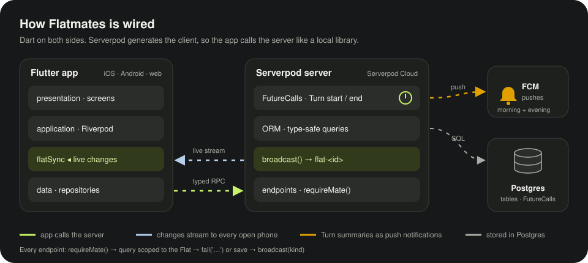
</p>

Both sides are written in Dart, and Serverpod generates the code that connects them. The server defines models and endpoints; `serverpod generate` turns them into the `flatmates_client` package. The Flutter app then calls the server through that package as if it were a local Dart library, with no hand-written JSON or REST routes.

### How the server uses Serverpod

| Serverpod feature | How Flatmates uses it | Where |
|---|---|---|
| **Models** (`.spy.yaml`) | Each domain type (Flat, Mate, Chore, Turn, Away, Event, Notice, Grocery item, SwapDebt…) is a YAML model. Serverpod generates the Dart classes, the serialisation, and the database table, with indexes and unique constraints. Enums (`AwayRule`, `TurnStatus`, `MateColor`, `FlatChangeKind`) are generated the same way. | `lib/src/models/` |
| **Endpoints** | Six endpoint classes (`flat`, `chore`, `away`, `event`, `notice`, `grocery`). Each public method becomes a typed call in the app, such as `client.chore.markDone(turnId)`. | `lib/src/endpoints/` |
| **ORM** | Queries use the generated, type-safe database API, for example `Mate.db.find(session, where: (t) => t.flatId.equals(id) & t.leftAt.equals(null))`. Multi-step writes, such as advancing a Chore's Rotation and inserting its next Turn, run inside `session.db.transaction`. | everywhere, e.g. `flat_access.dart`, `turn_service.dart` |
| **Migrations** | `serverpod create-migration` produces SQL migrations, which are committed and applied on start with `--apply-migrations`. | `migrations/` |
| **Serializable exceptions** | `FlatmatesException` is declared as a model (`exception:`), so when the server throws it, the app receives the same typed exception and can show its `message` straight to the Mate. | `models/flatmates_exception.spy.yaml`, `fail()` in `flat_access.dart` |
| **Streaming methods + message channels** | `FlatEndpoint.changes()` returns a `Stream<FlatChange>` built from `session.messages.createStream('flat-<id>')`. Every change calls `broadcast()`, which runs `session.messages.postMessage(...)`, so all open apps in that Flat hear about it instantly. | `flat_endpoint.dart`, `flat_access.dart` |
| **FutureCalls** | Each Turn's start, 3-hour reminder and end are scheduled as FutureCalls with stable IDs. They're stored in Postgres, so they survive restarts and can be cancelled when a Chore changes. | `future_calls/turn_calls.dart`, `rotation/turn_service.dart` |
| **Auth (`serverpod_auth_idp`)** | Google sign-in, with JWT access and refresh tokens. `currentUserId(session)` is the only place the server reads the signed-in user. | `server.dart`, `lib/src/auth/`, `flat_access.dart` |
| **Passwords / config** | Secrets (`googleClientSecret`, `fcmServiceAccount`, DB passwords) come from `config/passwords.yaml` locally and from Cloud passwords in production. Per-environment settings live in `config/*.yaml`. | `config/` |
| **Web server** | Serverpod's built-in web server hosts the Flutter web build at `/app`, along with a route that serves the app its `config.json`. | `server.dart`, `lib/src/web/routes/` |
| **Testing (`serverpod_test`)** | `withServerpod` starts a real server against the test database. `AuthenticationOverride` lets one test act as several different Mates. | `test/integration/` |
| **Serverpod Cloud** | One-command deploy with managed Postgres. Before each deploy, it runs `serverpod generate` and builds the web app. | `scloud.yaml` |

**What every endpoint does, in order:**
1. Call `requireMate(session)` or `requireAdmin(session)`. This looks up the caller's active Mate and their Flat, and fails if the caller isn't in one.
2. Scope every query to `flat.id`, so a Mate can never read or change another Flat's data.
3. Reject invalid requests with `fail('…')`, which carries a message fit to show the user.
4. After a change, call `broadcast(session, flatId, FlatChangeKind.x)` so the other phones refresh.

### How the Flutter app is built

| Piece | Package | How it's used |
|---|---|---|
| Server client | `flatmates_client` (generated) + `serverpod_flutter` | One `Client` is created in `main.dart`, with `FlutterConnectivityMonitor` and `FlutterAuthSessionManager`, and provided to the whole app through `clientProvider`. |
| Sign-in | `serverpod_auth_idp_flutter` | Google sign-in on Android, iOS and web, with the session restored at startup by `client.auth.initialize()`. |
| State | `flutter_riverpod` 3 | Hand-written `Notifier` and `AsyncNotifier` providers, with no code generation. |
| Navigation | `auto_route` | Typed routes from `@RoutePage` screens, generated into `app/router.gr.dart`. A tab shell holds Home, Chores, Calendar, Groceries and Flat. |
| Push | `firebase_messaging` | `core/services/push_service.dart` registers the device's FCM token with `client.flat.registerDevice`. |
| UI | `motor`, `stupid_simple_sheet`, `hugeicons` | Spring animations, bottom sheets and icons. Theme tokens are in `core/theme/app_theme.dart`, copied from `design/`. |
| Other | `share_plus`, `shared_preferences`, `flutter_timezone`, `intl` | Sharing the Invite code, remembering the theme choice, finding the phone's timezone, and formatting dates. |

**Every feature follows the same four-layer pattern**, in `lib/features/<feature>/`:

```
presentation/   screens + widgets         ref.watch(...) to render, ref.read(...).run to act
application/    Riverpod controllers      own the data, optimistic updates, roll back on error
                <feature>_actions.dart     one ActionNotifier per slow action (spinner + no double taps)
domain/         view models               shape server data for the screens
data/           repository                thin wrapper over client.<endpoint>.<method>()
```

**Live updates in the app:**
- `flatChangesProvider` (`features/flat/application/flat_changes.dart`) listens to `client.flat.changes()`.
- If the connection drops, it marks the app offline, retries every 3 seconds, and emits a `flat` change once it's back so everything is refetched.
- `flatSyncProvider` (`features/home/application/flat_sync.dart`) maps each `FlatChangeKind` (`flat`, `chores`, `away`, `events`, `notices`, `groceries`) to the providers it should refresh.

**Tests:** widget tests replace the repository providers with an in-memory `FakeBackend` (`test/support/fakes.dart`), so they run the real screens and controllers without a server.

### Example: one Mate marks a Turn Done

<p align="center">
  
</p>

1. **Button.** On Home, the Turn card's button calls `markDoneProvider(turnId).notifier.run`. The button shows a spinner while `isLoading` is true, and further taps do nothing.
2. **Optimistic update.** `ChoresNow` (`chore_turns.dart`) marks the Turn Done on screen immediately, then the chores controller calls `ChoreRepository`. The repository calls `client.chore.markDone(turnId)`, which sends a typed RPC generated by Serverpod.
3. **Server.** `ChoreEndpoint.markDone` checks the caller with `requireMate`. Then `TurnService.markDone` checks that the Turn belongs to this Flat and Mate, is still active and has started, saves it, and calls `broadcast(..., FlatChangeKind.chores)`.
4. **Other phones.** Serverpod's message channel pushes a `FlatChange(chores)` down each open phone's `changes()` stream. Their `flatSyncProvider` refreshes the chore providers, and the Turn appears Done on every phone.
5. **On failure.** If the server throws a `FlatmatesException`, the controller undoes its local change and the app shows the exception's message.

### Other rules

- **Time.** All instants are stored in UTC (`DateTime.now().toUtc()`) and shown in the phone's local time.
- **Soft deletes.** A Mate who leaves keeps their row, with `leftAt` set. Active Mates are those where `leftAt == null`, so always filter on that (`activeMates()`).
- **Adding a new kind of data.** It needs a `FlatChangeKind` value, a `broadcast` call on the server, and a matching case in `flatSync` in the app.

## How rotation works

- Each **Chore** has a **Rotation** (ordered Mates, repeats allowed) and a **Rotation period**.
  A **Turn** is one Mate's responsibility for one period; it ends when the period ends, **Done** or **Missed**.
- Each Turn's morning summary, 3-hour reminder and end are Serverpod **FutureCalls** (`TurnCalls`),
  so they survive restarts. Turn end marks Missed if needed and creates the next Turn.
- Pushes are one per Mate, not one per Turn: a morning summary of their Turns for the day (time set
  by the Admin, 08:00 by default) and, 3 hours before midnight, their own Turns not Done plus their
  Mates' ones. Of all the calls due at that moment, the Flat's oldest Turn's sends for everyone.
  Done and Missed send nothing.
- The Flat-wide **Away rule** (Admin picks): **Swap** (next Mate covers, Away Mate does their next
  Turn in return), **Skip** (next Mate covers, nothing owed), **Pause** (Chore waits; Away days
  mid-Turn extend it). If nobody can cover, the Chore pauses.
- Pure planning logic: `flatmates_shared/lib/src/planner.dart`; DB + scheduling:
  `turn_service.dart`. Live app updates stream over `flat.changes()`.

## Known simplifications

- The Flat's timezone is stored but not used yet. Times are shown in each phone's local time.
- Cancelling an Away keeps any covers already arranged for it.
- A change to the Rotation period applies from the next Turn.

## License

See [LICENSE](LICENSE).
